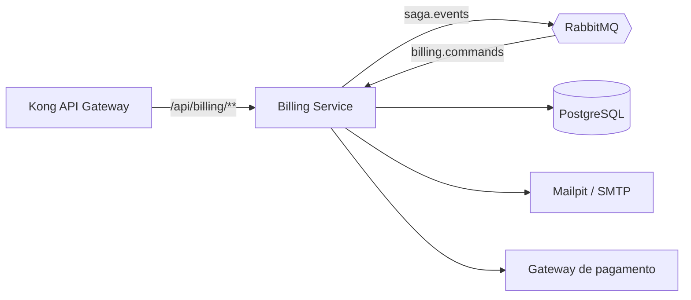

# Billing Service

Microsserviço de cobrança da oficina mecânica (Tech Challenge — Fase 4). Gera o orçamento da ordem de serviço, registra a resposta do cliente, cria e verifica o pagamento e faz o estorno quando a Saga é compensada.

## Visão do serviço



O serviço não chama nenhum outro serviço e não lê nenhum outro banco. Tudo o que ele sabe sobre a OS (cliente, veículo, itens já precificados) chega no comando `billing.budget.generate`.

### Participação na Saga

| Comando recebido | O que faz | Resposta |
|---|---|---|
| `billing.budget.generate` | Cria o orçamento e envia por e-mail, com links de aprovar e recusar | `billing.budget.sent` ou `billing.budget.failed` |
| — (ação do cliente) | Registra a aprovação ou a recusa | `billing.budget.approved` / `billing.budget.rejected` |
| `billing.payment.create` | Cria a cobrança no gateway e envia o link ao cliente | `billing.payment.created`, depois `billing.payment.confirmed` / `billing.payment.failed` |
| `billing.payment.refund` | Estorna o pagamento confirmado (compensação) | `billing.payment.refunded` |
| `billing.budget.cancel` | Cancela o orçamento e a cobrança ainda não paga (compensação) | — |

Comandos são idempotentes: uma reentrega é reconhecida e ignorada. As respostas são gravadas em uma outbox na mesma transação da mudança de estado.

### Camadas

Pacote raiz `org.project.mechanic_shop.billing`, em arquitetura hexagonal:

- `domain/`: `Budget`, `Payment`, enums, DTOs e eventos;
- `application/`: casos de uso (`services`), contratos da Saga (`saga`), portas (`ports`) e notificações (`listeners`);
- `infrastructure/`: JPA, outbox e RabbitMQ (`messaging`), e-mail e gateways de pagamento (`payment`);
- `presentation/`: controllers e tratamento de erros;
- `shared/config/`: segurança (JWT), observabilidade e Swagger.

## Pagamentos

A porta `PaymentGateway` isola o provedor. O adapter é escolhido por `PAYMENT_PROVIDER`:

- `simulated` (padrão): aceita toda cobrança. O resultado é decidido por `POST /api/billing/payments/{serviceOrderId}/simulate`.
- `mercadopago`: **preparado, não implementado.** `MercadoPagoPaymentGateway` documenta as três chamadas a implementar (criar preferência, validar e resolver o webhook, estornar). O endpoint `POST /api/billing/webhooks/mercadopago` e as variáveis `MERCADOPAGO_*` já existem.

## API

| Método e rota | Perfis | Descrição |
|---|---|---|
| `GET /api/billing/budgets/{serviceOrderId}` | equipe, cliente dono | Orçamento da OS |
| `POST /api/billing/budgets/{serviceOrderId}/response` | cliente dono, admin | Aprova ou recusa |
| `GET /api/billing/budgets/approval?token=&approved=` | público (token de uso único) | Link do e-mail |
| `GET /api/billing/payments/{serviceOrderId}` | admin, recepção, cliente dono | Pagamento e link de checkout |
| `POST /api/billing/payments/{serviceOrderId}/simulate` | cliente dono, admin | Simula a resposta do gateway |
| `POST /api/billing/webhooks/mercadopago` | público (assinatura) | Notificações do Mercado Pago |

Swagger: `http://localhost:8081/api/billing/swagger-ui/index.html`. O JWT é o emitido pelo OS Service ou pelo login por CPF; o papel vem no claim `role`.

## Execução

Para subir os três serviços juntos, use o `docker compose` da pasta que os reúne. Para rodar só este serviço, ele precisa de um PostgreSQL e de um RabbitMQ:

```bash
./mvnw spring-boot:run
```

| Variável | Padrão | Uso |
|---|---|---|
| `SPRING_DATASOURCE_URL` / `_USERNAME` / `_PASSWORD` | `jdbc:postgresql://localhost:5433/billing-db` | Banco do serviço |
| `RABBITMQ_HOST` / `_PORT` / `_USERNAME` / `_PASSWORD` | `localhost:5672`, guest | Broker da Saga |
| `JWT_SECRET`, `JWT_ISSUER` | — | Devem ser iguais aos do OS Service |
| `APP_BASE_URL` | `http://localhost:8000` | Base dos links enviados por e-mail |
| `PAYMENT_PROVIDER` | `simulated` | `simulated` ou `mercadopago` |
| `SMTP_ACTIVE`, `SMTP_HOST`, `SMTP_PORT` | `false` | E-mail real; sem isso, o e-mail é só registrado no log |

## Testes

```bash
./mvnw verify
```

- Testes unitários de domínio, casos de uso, controllers, segurança e infraestrutura.
- BDD em `src/test/resources/features/orcamento_e_pagamento.feature` (8 cenários, do orçamento ao estorno).
- Teste da aplicação inteira com banco em memória (transações, outbox e segurança).
- O build falha se a cobertura de linhas ficar abaixo de 80%. Medição em 10/10/2026: **110 testes, 99,0% de linhas** (`target/site/jacoco/index.html`).
