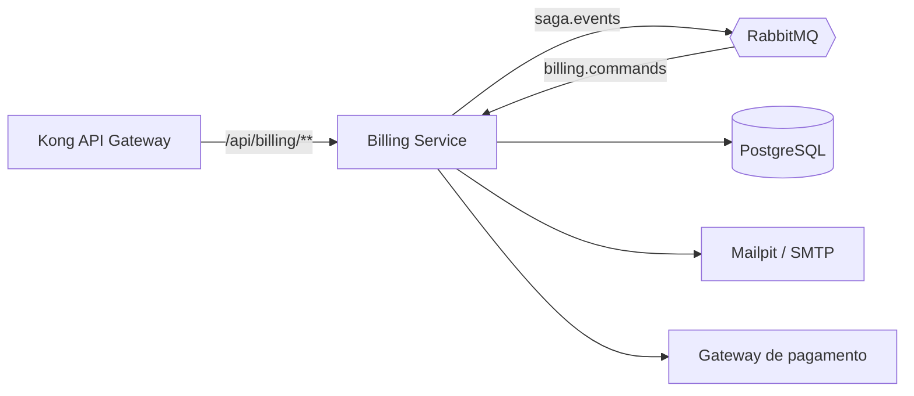
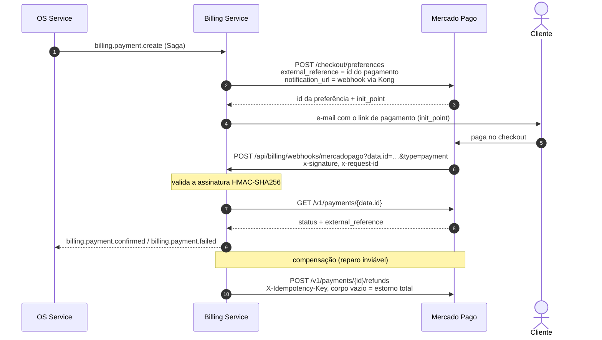

# Billing Service

Microsserviço de cobrança da oficina mecânica (Tech Challenge — Fase 4). Gera o orçamento da ordem de serviço, registra a resposta do cliente, cria e verifica o pagamento e faz o estorno quando a Saga é compensada.

## Visão do serviço



O serviço não chama nenhum outro serviço e não lê nenhum outro banco. Tudo o que ele sabe sobre a OS (cliente, veículo, itens já precificados) chega no comando `billing.budget.generate`.

### Participação na Saga

| Comando recebido | O que faz | Resposta |
|---|---|---|
| `billing.budget.generate` | Cria o orçamento e envia por e-mail, com links de aprovar e recusar | `billing.budget.sent` ou `billing.budget.failed` |
| — (ação do cliente) | Registra a aprovação ou a recusa | `billing.budget.approved` / `billing.budget.rejected` |
| `billing.payment.create` | Cria a cobrança no gateway e envia o link ao cliente | `billing.payment.created`, depois `billing.payment.confirmed` / `billing.payment.failed` |
| `billing.payment.refund` | Estorna o pagamento confirmado (compensação) | `billing.payment.refunded` |
| `billing.budget.cancel` | Cancela o orçamento e a cobrança ainda não paga (compensação) | — |

Comandos são idempotentes: uma reentrega é reconhecida e ignorada. As respostas são gravadas em uma outbox na mesma transação da mudança de estado.

A arquitetura do serviço (componentes, modelo de dados, ciclo de vida e participação na Saga) está em [docs/architecture.md](docs/architecture.md).

### Camadas

Pacote raiz `org.project.mechanic_shop.billing`, em arquitetura hexagonal:

- `domain/`: `Budget`, `Payment`, enums, DTOs e eventos;
- `application/`: casos de uso (`services`), contratos da Saga (`saga`), portas (`ports`) e notificações (`listeners`);
- `infrastructure/`: JPA, outbox e RabbitMQ (`messaging`), e-mail e gateways de pagamento (`payment`);
- `presentation/`: controllers e tratamento de erros;
- `shared/config/`: segurança (JWT), observabilidade e Swagger.

## Pagamentos

A porta `PaymentGateway` isola o provedor. O adapter é escolhido por `PAYMENT_PROVIDER`:

- `simulated` (padrão): aceita toda cobrança. O resultado é decidido por `POST /api/billing/payments/{serviceOrderId}/simulate`. Usado no desenvolvimento local, no `scripts/saga_e2e.sh` e no k6.
- `mercadopago`: integração com o **Mercado Pago Checkout Pro** (`MercadoPagoPaymentGateway`). Com ele, o `/simulate` é recusado (409).

### Fluxo com o Mercado Pago



- **Webhook autenticado:** `x-signature` (`ts=…,v1=…`) é o HMAC-SHA256, em hex, do manifesto `id:<data.id>;request-id:<x-request-id>;ts:<ts>;`, com a chave secreta do webhook. É o mesmo cálculo do SDK oficial. Assinatura ausente, malformada ou errada recebe **401**.
- **Fonte da verdade é a API:** o corpo do webhook nunca define o status; o Billing sempre consulta `GET /v1/payments/{id}`. O pagamento é ligado ao nosso pela `external_reference`.
- **Status:** `approved` confirma; `rejected` e `cancelled` falham o pagamento (a Saga compensa); os demais (`pending`, `in_process`…) aguardam a próxima notificação.
- **Idempotência:** notificações repetidas para um pagamento já resolvido são ignoradas. A criação da preferência envia `X-Idempotency-Key` = id do pagamento; o estorno envia `refund-<id do pagamento>`.
- **Ignorados com 200:** notificações IPN legadas (`?topic=`) e tipos diferentes de `payment` (por exemplo, `merchant_order`).
- **Pagamento após o cancelamento:** se o cliente pagar uma cobrança cuja Saga já foi compensada (prazo vencido), o valor é estornado automaticamente.

### Configuração

| Variável | Uso |
|---|---|
| `PAYMENT_PROVIDER=mercadopago` | Ativa o adapter |
| `MERCADOPAGO_ACCESS_TOKEN` | Access Token da aplicação (de teste ou de produção), em *Suas integrações > Credenciais* |
| `MERCADOPAGO_WEBHOOK_SECRET` | Assinatura secreta, em *Suas integrações > Webhooks > Configurar notificações* |
| `MERCADOPAGO_NOTIFICATION_URL` | URL **pública** do webhook. Padrão: `${APP_BASE_URL}/api/billing/webhooks/mercadopago`, ou seja, o Kong |
| `MERCADOPAGO_API_BASE_URL` | Padrão `https://api.mercadopago.com` (trocado só em testes) |

Para testar com o sandbox: crie uma aplicação e usuários de teste no painel do Mercado Pago, use o Access Token de teste e pague com os cartões de teste. O webhook precisa de uma URL pública: no EKS é o Load Balancer do Kong; localmente, um túnel (por exemplo `ngrok http 8000`) com `MERCADOPAGO_NOTIFICATION_URL=https://<túnel>/api/billing/webhooks/mercadopago`.

## API

| Método e rota | Perfis | Descrição |
|---|---|---|
| `GET /api/billing/budgets/{serviceOrderId}` | equipe, cliente dono | Orçamento da OS |
| `POST /api/billing/budgets/{serviceOrderId}/response` | cliente dono, admin | Aprova ou recusa |
| `GET /api/billing/budgets/approval?token=&approved=` | público (token de uso único) | Link do e-mail |
| `GET /api/billing/payments/{serviceOrderId}` | admin, recepção, cliente dono | Pagamento e link de checkout |
| `POST /api/billing/payments/{serviceOrderId}/simulate` | cliente dono, admin | Simula a resposta do gateway |
| `POST /api/billing/webhooks/mercadopago` | público (assinatura) | Notificações do Mercado Pago |

Swagger: `http://localhost:8081/api/billing/swagger-ui/index.html`. O JWT é o emitido pelo OS Service ou pelo login por CPF; o papel vem no claim `role`.

## Execução

Para subir os três serviços juntos, use o `docker-compose.full.yaml` do repositório `mechanic-shop-os-service` (com os três repositórios clonados lado a lado): `docker compose -f docker-compose.full.yaml up --build -d`. Para rodar só este serviço, ele precisa de um PostgreSQL e de um RabbitMQ:

```bash
./mvnw spring-boot:run
```

| Variável | Padrão | Uso |
|---|---|---|
| `SPRING_DATASOURCE_URL` / `_USERNAME` / `_PASSWORD` | `jdbc:postgresql://localhost:5433/billing-db` | Banco do serviço |
| `RABBITMQ_HOST` / `_PORT` / `_USERNAME` / `_PASSWORD` | `localhost:5672`, guest | Broker da Saga |
| `JWT_SECRET`, `JWT_ISSUER` | — | Devem ser iguais aos do OS Service |
| `APP_BASE_URL` | `http://localhost:8000` | Base dos links enviados por e-mail |
| `PAYMENT_PROVIDER` | `simulated` | `simulated` ou `mercadopago` (ver [Pagamentos](#pagamentos)) |
| `SMTP_ACTIVE`, `SMTP_HOST`, `SMTP_PORT` | `false` | E-mail real; sem isso, o e-mail é só registrado no log |

## Testes

```bash
./mvnw verify
```

- Testes unitários de domínio, casos de uso, controllers, segurança e infraestrutura.
- BDD em `src/test/resources/features/orcamento_e_pagamento.feature` (8 cenários, do orçamento ao estorno).
- Teste da aplicação inteira com banco em memória (transações, outbox e segurança).
- O build falha se a cobertura de linhas ficar abaixo de 80%.

### Evidência de cobertura

Medição de 09/11/2026 (`./mvnw verify`, todos os testes passando):

| Testes | Linhas | Condições | Cobertura no SonarCloud (linhas + condições) |
|---|---|---|---|
| 143 | 98,9% | 89,2% | **96,9%** |

- Relatório JaCoCo local: `target/site/jacoco/index.html`.
- No CI, todo PR e todo push publica o relatório como artefato `coverage-report` do workflow e envia a cobertura ao SonarCloud, cujo quality gate precisa passar: [painel do projeto](https://sonarcloud.io/summary/overall?id=EddieMarley23_mechanic-shop-billing-service).

## CI/CD

O workflow `.github/workflows/ci-cd.yml` roda `./mvnw verify` (com o gate de 80% de cobertura) em todo PR para `master`, publica o relatório de cobertura como artefato e, se o secret `SONAR_TOKEN` existir, faz a análise no SonarQube/SonarCloud com quality gate. No push para `master`, publica a imagem no Docker Hub e aplica `k8s/` no EKS, no namespace `mechanic-shop`.

O RabbitMQ, o Kong e o Mailpit do cluster são implantados pelo pipeline do OS Service; no primeiro deploy, rode-o antes deste. O Kong encaminha ``/api/billing/**`` para o Service ``billing-service:8081``.

| GitHub | Nome |
|---|---|
| Secrets | `AWS_ROLE_TO_ASSUME`, `DOCKERHUB_TOKEN`, `JWT_SECRET`, `DATABASE_URL`, `DATABASE_USERNAME`, `DATABASE_PASSWORD` (banco PostgreSQL próprio, separado do OS), `RABBITMQ_USERNAME`, `RABBITMQ_PASSWORD`, `NEW_RELIC_LICENSE_KEY`, `SONAR_TOKEN` (opcional), `MERCADOPAGO_ACCESS_TOKEN`, `MERCADOPAGO_WEBHOOK_SECRET` |
| Variables | `AWS_REGION`, `DOCKERHUB_USERNAME`, `EKS_CLUSTER_NAME`, `NEW_RELIC_APP_NAME`, `SONAR_PROJECT_KEY`, `SONAR_ORGANIZATION`, `SONAR_HOST_URL`, `APP_BASE_URL` (URL pública do Kong, base dos links do e-mail), `PAYMENT_PROVIDER` (padrão `simulated`) |

`JWT_SECRET` e `RABBITMQ_USERNAME`/`RABBITMQ_PASSWORD` precisam ter o mesmo valor nos três repositórios.
