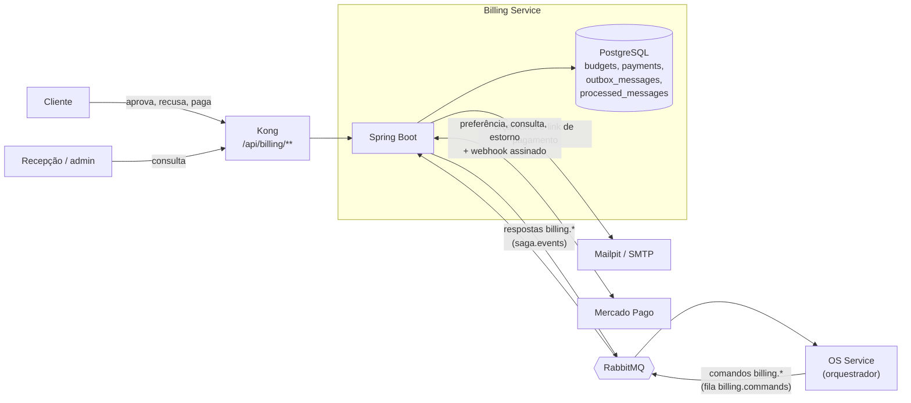
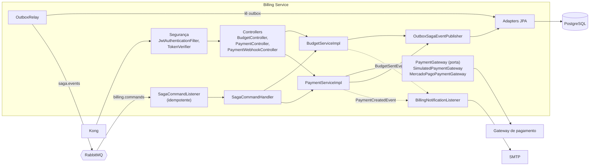
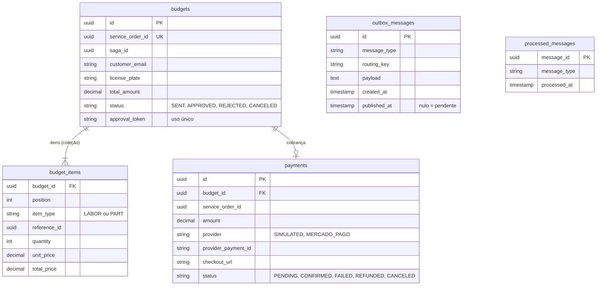
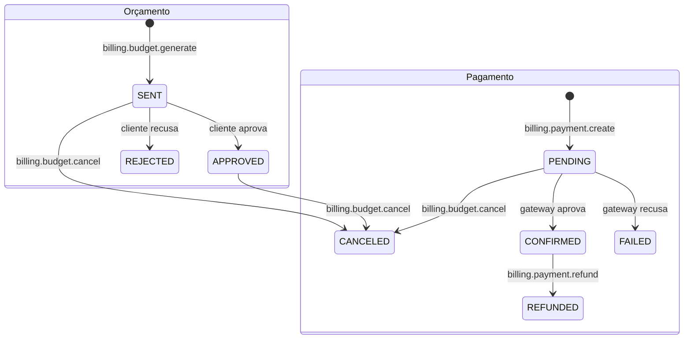
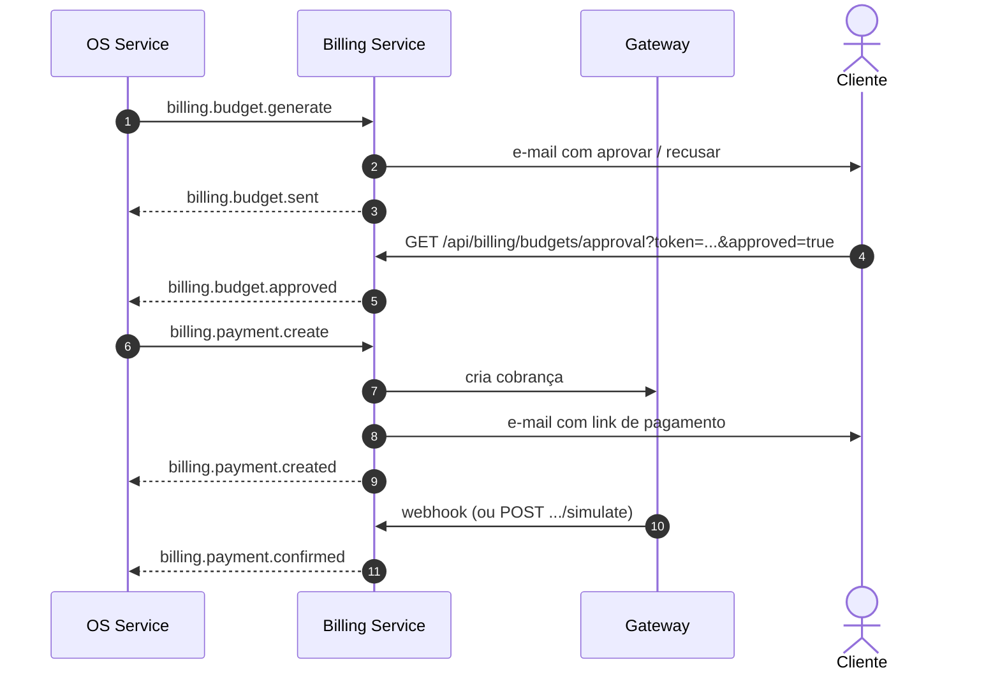

# Arquitetura do Billing Service

Microsserviço de cobrança da oficina. Participa da Saga da ordem de serviço, orquestrada pelo OS Service: gera o orçamento, registra a resposta do cliente, cria e verifica o pagamento e estorna quando a Saga é compensada. A visão do sistema inteiro (os três serviços, a Saga e a implantação) está no repositório do OS Service, em `docs/architecture/`.

## Contexto

O serviço não chama nenhum outro serviço e não lê nenhum outro banco. Tudo o que ele precisa saber sobre a OS chega no comando `billing.budget.generate`: cliente, e-mail, placa e itens **já precificados** pelo OS Service. O Billing só confere se o total bate com a soma dos itens.

## Componentes

| Componente | Responsabilidade |
|---|---|
| `SagaCommandListener` + `SagaCommandHandler` | Consome `billing.commands`, descarta reentregas (`processed_messages`) e despacha para o caso de uso |
| `BudgetServiceImpl` | Cria o orçamento, gera o token de aprovação de uso único, registra aprovação, recusa e cancelamento |
| `PaymentServiceImpl` | Cria a cobrança, trata o retorno do gateway (webhook ou simulação), estorna e cancela |
| `PaymentGateway` | Porta que isola o provedor. O adapter é escolhido por `PAYMENT_PROVIDER` (`simulated` ou `mercadopago`) |
| `OutboxSagaEventPublisher` + `OutboxRelay` | Grava a resposta da Saga na mesma transação da mudança de estado e publica em `saga.events` |
| `BillingNotificationListener` | Envia o e-mail do orçamento (links de aprovar e recusar) e o do link de pagamento, após o commit |
| Segurança | Valida o JWT emitido pelo OS Service ou pela Lambda; o perfil vem no claim `role`. O cliente só acessa a própria OS (e-mail do token = e-mail do orçamento) |

## Modelo de dados

## Ciclo de vida

## Participação na Saga

| Comando recebido | Ação | Resposta |
|---|---|---|
| `billing.budget.generate` | Valida os itens, cria o orçamento `SENT` e envia o e-mail | `billing.budget.sent` ou `billing.budget.failed` |
| — (cliente, via link ou API) | Aprova ou recusa | `billing.budget.approved` / `billing.budget.rejected` |
| `billing.payment.create` | Cria a cobrança no gateway e envia o link | `billing.payment.created` |
| — (webhook ou simulação) | Resultado do gateway | `billing.payment.confirmed` / `billing.payment.failed` |
| `billing.payment.refund` | Estorna o pagamento confirmado (compensação) | `billing.payment.refunded` |
| `billing.budget.cancel` | Cancela o orçamento e a cobrança ainda não paga (compensação) | — |

## Decisões

- **PostgreSQL:** orçamento e pagamento são valores monetários com transições que precisam ser atômicas junto com a outbox. Um banco relacional com transação ACID é a escolha natural.
- **Porta de pagamento:** o resto do serviço (ciclo do pagamento, webhook, respostas da Saga, estorno) não conhece o provedor. O adapter `MercadoPagoPaymentGateway` implementa o Checkout Pro: cria a preferência, valida a assinatura do webhook (HMAC-SHA256, como o SDK oficial), consulta o pagamento na API e estorna. O `SimulatedPaymentGateway` continua disponível para desenvolvimento e testes de carga.
- **Token de aprovação de uso único:** o cliente aprova pelo link do e-mail sem precisar de login. O token é invalidado na primeira resposta.
- **Idempotência:** comandos reentregues são reconhecidos pelo `messageId` (`processed_messages`). O contrato do gateway exige idempotência: a cobrança leva o id do pagamento como referência, e o estorno, uma chave de idempotência.
- **Compensações seguras:** cancelar um orçamento já cancelado ou recusado não faz nada, e estornar exige pagamento confirmado.

## Observabilidade

Logs estruturados em JSON (perfil `prod`), `correlationId` lido das mensagens e propagado no MDC e no New Relic, e eventos `MechanicShopSagaFailure` e `MechanicShopIntegrationFailure` para falhas de passo e de integração.
